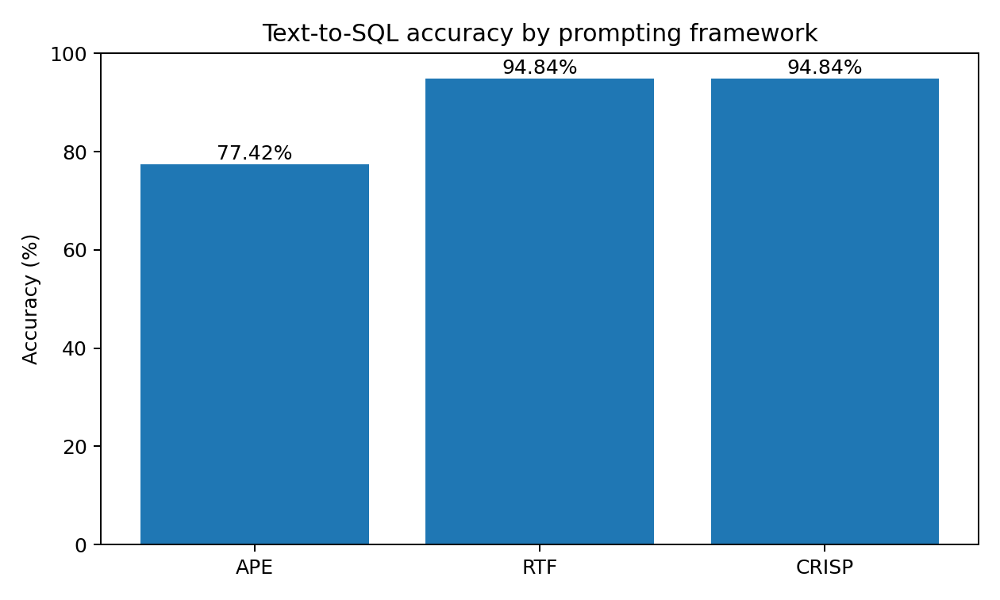
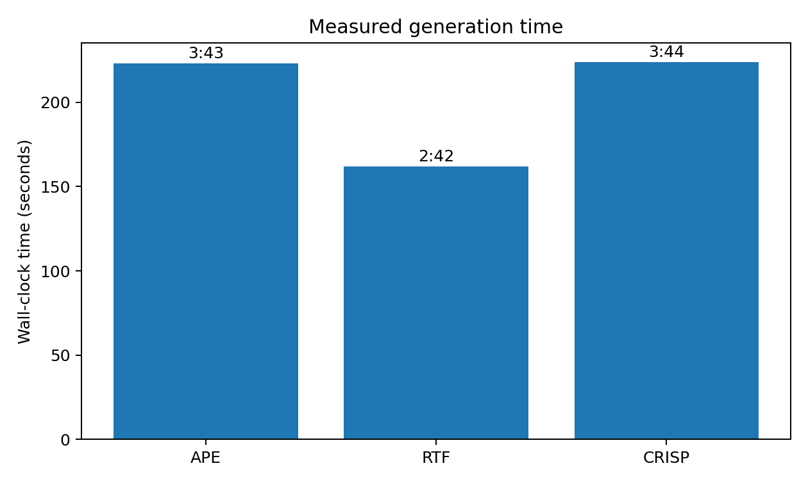

# Task 2 — Prompting Framework Comparison

## Experimental setup

The same configuration was used for all three runs:

- Agent: **Codex Agent**
- Model: **GPT-5.6-Sol (ChatGPT)**
- Reasoning effort: **Low**
- Dataset: **155 questions**
- A new chat session was started for each prompt.
- The same schema, database, dataset, and evaluator were used in all runs.

## Prompt identification metadata

| Framework | Prompt file | Prediction file |
|---|---|---|
| APE | `Task_1/prompt-ape.txt` | `Task_2/modelAnswers/Result-ape.csv` |
| RTF | `Task_1/prompt-rtf.txt` | `Task_2/modelAnswers/Result-rtf.csv` |
| CRISP | `Task_1/prompt-crisp.txt` | `Task_2/modelAnswers/Result-crisp.csv` |

## Results

| Framework | Correct | Accuracy | Measured time |
|---|---:|---:|---:|
| APE | 120/155 | 77.42% | 3:43 |
| RTF | 147/155 | 94.84% | 2:42 |
| CRISP | 147/155 | 94.84% | 3:44 |

The measured times above are wall-clock times recorded immediately before and after each run.

## Comparison

RTF and CRISP achieved the same highest accuracy: **94.84% (147/155)**.

APE achieved **77.42% (120/155)**, which is **17.42 percentage points lower** than RTF and CRISP.

The identical accuracy of RTF and CRISP initially raised a concern that the agent might have reused or copied an existing prediction file from the project. To verify this, the two generated CSV files were compared. The files were not identical: 5 out of 155 predictions differed. This confirmed that the two result files were generated independently rather than being exact copies, even though they achieved the same final accuracy.

RTF was also the fastest run by the measured wall-clock time: **2:42**, compared with **3:43** for APE and **3:44** for CRISP.

## Visualisation

### Accuracy

### Measured generation time

## Conclusion

In this experiment, **RTF and CRISP performed equally well in accuracy**, both reaching **94.84%**. **RTF required less measured generation time**, while **APE produced substantially fewer correct predictions**.

The comparison was performed under the same agent, model, reasoning effort, dataset, and evaluation procedure, with a separate chat session for each prompting framework.
