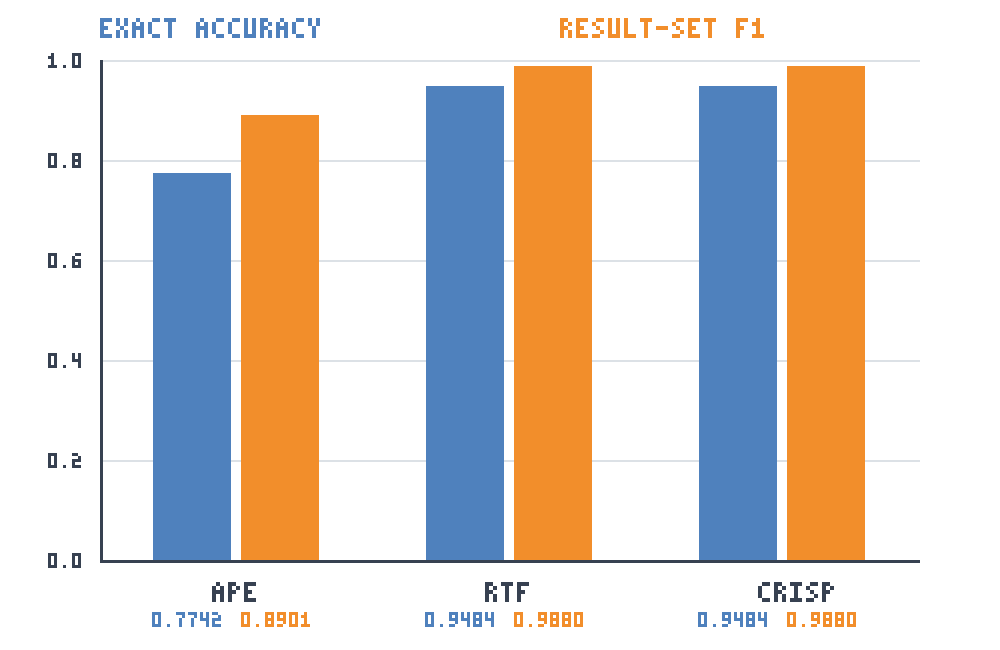

# Task 3 — Alternative Evaluation Metric

## Proposed metric

The proposed alternative metric is **Result-Set F1 Score**.

The F1 Score is a standard evaluation metric that combines Precision and Recall into a single value. Precision measures how many of the returned rows are correct, while Recall measures how many of the expected rows were successfully retrieved. The standard F1 formula is used here, but it is applied to SQL result sets instead of classification labels.

For each natural-language question, the SQL prediction is executed against the restaurant database. Its returned rows are compared with the expected rows as multisets, so duplicate rows retain their multiplicity. A row contributes to the overlap only as many times as it occurs in both multisets.

## Why this metric is applicable

The original Exact Accuracy metric assigns either 1 to a completely matching result set or 0 to every other result. This strict criterion is useful, but it treats a nearly correct query in the same way as a completely wrong query. Result-Set F1 gives partial credit when a query retrieves some correct rows while omitting expected rows or adding incorrect rows. It therefore measures the degree of retrieval correctness in cases where exact matching fails.

## Relationship to the original metric

Result-Set F1 **complements** Exact Accuracy. Exact Accuracy measures the proportion of questions answered with fully correct result sets. Result-Set F1 measures how close partially incorrect answers are to the expected results. The report makes a distinction between the complete fulfillment of a task and a useful but incomplete extraction of data.

## Calculation

For a question, let the number of correctly returned rows be the size of the multiset intersection between predicted and expected rows. Then:

$$
\text{Precision} =
\frac{\text{correctly returned rows}}
{\text{predicted rows}}
$$

$$
\text{Recall} =
\frac{\text{correctly returned rows}}
{\text{expected rows}}
$$

$$
F_1 =
\frac{
2 \times \text{Precision} \times \text{Recall}
}{
\text{Precision} + \text{Recall}
}
$$
Macro Result-Set F1 is the arithmetic mean of the 155 per question F1 scores, giving every question equal weight. If both expected and predicted results are empty, F1 is 1.0. If only one is empty, F1 is 0.0. Invalid SQL and missing predictions also receive 0.0.

## Results

| Framework | Exact Accuracy | Result-Set F1 |
|---|---:|---:|
| APE | 0.7742 | 0.8901 |
| RTF | 0.9484 | 0.9880 |
| CRISP | 0.9484 | 0.9880 |

All three prediction files contained predictions for all 155 questions, and all predicted SQL statements executed successfully.

## Comparison

RTF and CRISP achieve the strongest performance under both measures. Their Macro Result-Set F1 values are identical even at higher precision (0.987979248669), so the alternative metric does not separate them on this dataset. APE has a lower Result-Set F1 of 0.8901, but this is higher than its Exact Accuracy of 0.7742. The difference shows that some APE predictions rejected by exact matching still return a meaningful portion of the expected rows. RTF and CRISP also rise from 0.9484 Exact Accuracy to 0.9880 Result-Set F1, indicating partial correctness among at least some of their non-exact results.

## Visualisation

## Conclusion

Result-Set F1 adds information about the quality of non-exact predictions by measuring both extra and missing rows.
