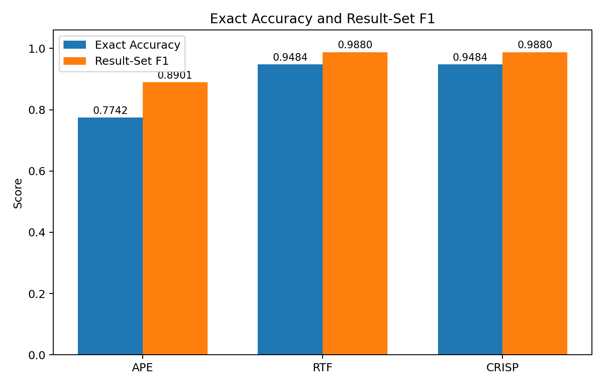
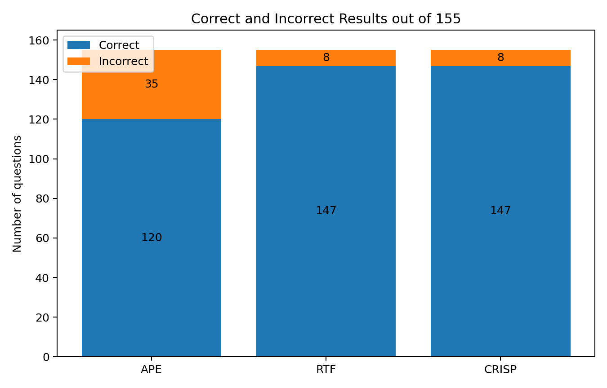
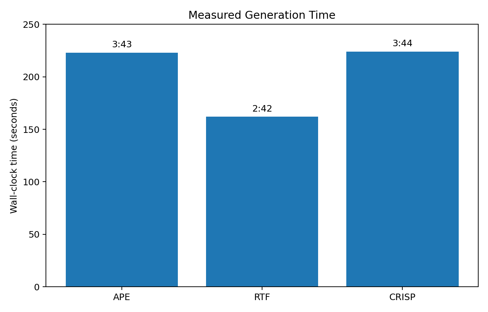
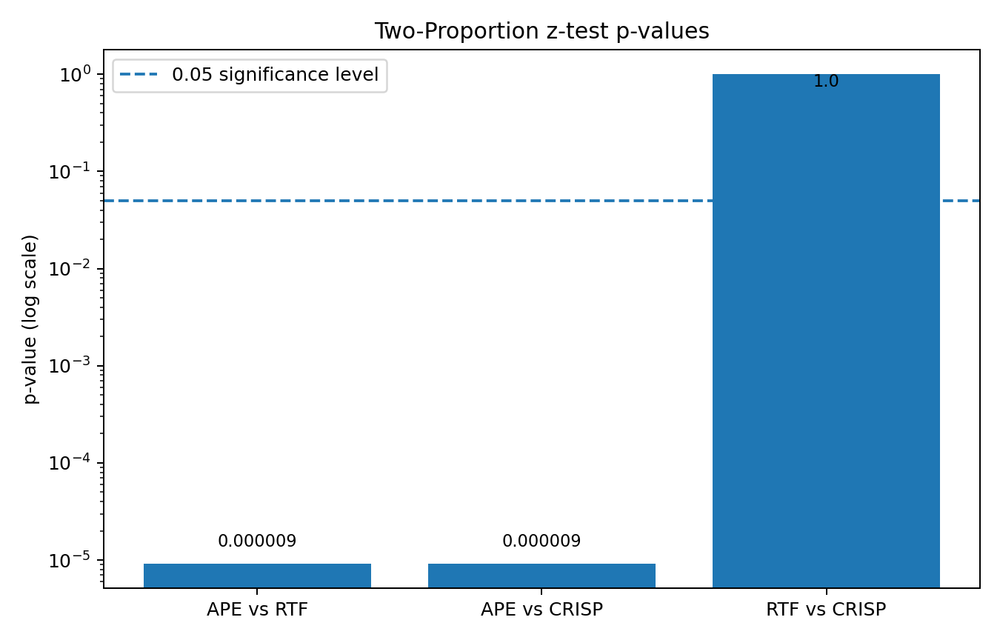

# Task 4 — Detailed Prompt Comparison

## Experimental Setup

The three prompting frameworks were evaluated under the same conditions.

| Setting | Value |
|---|---|
| Model | GPT-5.6-Sol (ChatGPT) |
| Coding agent | Codex Agent |
| Reasoning effort | Low |
| Number of questions | 155 |
| Sessions | A new session was used for each prompt |
| Data | The same database, schema, dataset, and evaluator were used |

The compared prompt frameworks were **APE**, **RTF**, and **CRISP**.

---

## Overall Results

| Framework | Correct | Incorrect | Exact Accuracy | Result-Set F1 | Invalid SQL | Missing predictions | Measured time |
|---|---:|---:|---:|---:|---:|---:|---:|
| APE | 120 | 35 | 0.7742 | 0.8901 | 0 | 0 | 3:43 |
| RTF | 147 | 8 | 0.9484 | 0.9880 | 0 | 0 | 2:42 |
| CRISP | 147 | 8 | 0.9484 | 0.9880 | 0 | 0 | 3:44 |

---

## Comparison of Metrics

### Exact Accuracy

Exact Accuracy gives a score of 1 only when the complete result set is correct.

- APE: **0.7742**
- RTF: **0.9484**
- CRISP: **0.9484**

RTF and CRISP clearly performed better than APE. APE had 35 incorrect exact-result predictions. RTF and CRISP had only 8 each.

### Result-Set F1

Result-Set F1 gives partial credit when a prediction returns some correct rows but is not completely correct.

- APE: **0.8901**
- RTF: **0.9880**
- CRISP: **0.9880**

APE has a higher F1 than Exact Accuracy. Some APE predictions that failed exact matching still returned part of the expected result.

RTF and CRISP also have slightly higher F1 than Exact Accuracy, their incorrect predictions were therefore often close to the expected result.
RTF and CRISP have the same final Accuracy and F1 values. However, their prediction files are not identical. Five of the 155 generated SQL queries differ.

---

## Statistical Significance

To check whether the differences in Exact Accuracy are statistically significant, I used a **two-proportion z-test**. This test compares the proportion of correct answers produced by two prompts.

The available results were:

| Framework | Correct | Total | Accuracy |
|---|---:|---:|---:|
| APE | 120 | 155 | 0.7742 |
| RTF | 147 | 155 | 0.9484 |
| CRISP | 147 | 155 | 0.9484 |

A difference was considered statistically significant when the p-value was below **0.05**.

### APE vs RTF

APE achieved an Exact Accuracy of **0.7742**, while RTF achieved **0.9484**.

The difference is **17.42 percentage points**.
The two-proportion z-test gives: **p ≈ 0.000009**. Since p < 0.05, the difference is statistically significant. RTF performed significantly better than APE in Exact Accuracy.

### APE vs CRISP

APE achieved an Exact Accuracy of **0.7742**, while CRISP achieved **0.9484**.

The difference is also **17.42 percentage points**.
The test gives: **p ≈ 0.000009**. Since p < 0.05, the difference is statistically significant. CRISP performed significantly better than APE in Exact Accuracy.

### RTF vs CRISP

RTF and CRISP both achieved an Exact Accuracy of **0.9484**.

The difference is **0 percentage points**.
The test gives: **p = 1.0**. Therefore, there is no statistically significant difference between RTF and CRISP.

### Statistical Summary

| Comparison | Accuracy difference | p-value | Result |
|---|---:|---:|---|
| APE vs RTF | 17.42 percentage points | 0.000009 | Significant |
| APE vs CRISP | 17.42 percentage points | 0.000009 | Significant |
| RTF vs CRISP | 0 percentage points | 1.0 | Not significant |
---

## Prompt Analysis

### APE

APE is structured as:

- Action
- Purpose
- Expectation

APE clearly describes the action and expected result, but it gives less detailed structure for the task than RTF and CRISP. In this experiment, APE had the lowest performance. APE still generated valid SQL for all questions, so its main problem was not SQL syntax. The problem was result correctness.

### RTF

RTF is structured as:

- Role
- Task
- Format

The prompt clearly separates what the model should do from how the final output should look. RTF also had the shortest measured time: **2 minutes 42 seconds**. In this experiment, RTF gave the best balance between quality and time.

### CRISP

CRISP is structured as:

- Context
- Role
- Intent
- Style
- Parameters

CRISP gives more context and more explicit constraints than APE and RTF. Its quality was equal to RTF, but its measured time was longer: **3 minutes 44 seconds**. In this experiment, the extra structure of CRISP did not improve the final metrics compared with RTF.

---

## Model Factor

The same model was used in all three experiments: **GPT-5.6-Sol (ChatGPT)**. The reasoning effort was also the same: **Low**. This means that the observed quality differences are connected mainly with how the instructions were structured, although a single experiment cannot prove that the prompt alone caused every difference.

---

## Coding Agent Factor

All three experiments used **Codex Agent**. The agent can influence execution because it decides how many steps to take, how to inspect the files, and how to create the final prediction file.

The Codex run information was:

| Framework | Agent steps | Codex reported time |
|---|---:|---:|
| APE | 32 | 2m 54s |
| RTF | 19 | 2m 18s |
| CRISP | 25 | 2m 52s |

RTF used the fewest agent steps and also had the shortest measured wall-clock time. This is consistent with the simpler Role–Task–Format structure, but one run is not enough to prove that the prompt structure alone caused the time difference.

---

## Visualisations

### Exact Accuracy and Result-Set F1

### Correct and Incorrect Results

### Measured Generation Time

### Statistical Significance

---

## Final Comparison

| Factor | APE | RTF | CRISP |
|---|---|---|---|
| Exact Accuracy | 0.7742 | **0.9484** | **0.9484** |
| Result-Set F1 | 0.8901 | **0.9880** | **0.9880** |
| Correct answers | 120 | **147** | **147** |
| Incorrect answers | 35 | **8** | **8** |
| Measured time | 3:43 | **2:42** | 3:44 |
| Statistical result vs APE | — | Significant | Significant |

---

## Conclusion

Based on the measured Accuracy, Result-Set F1, and execution time, **RTF gave the best overall result in this experiment**.
