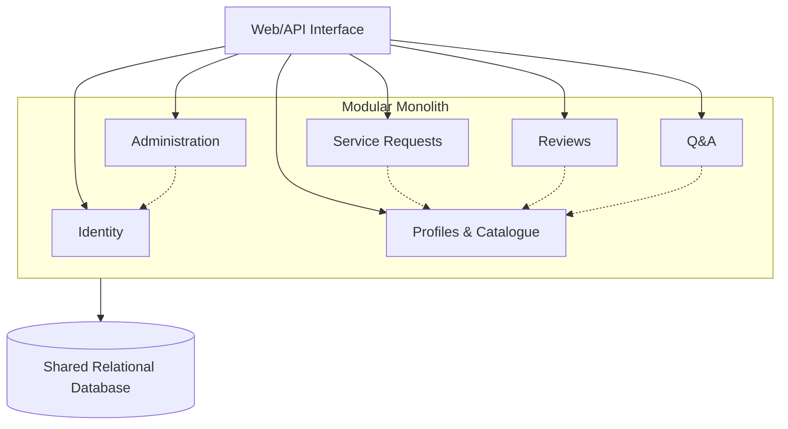

# ADR-001: Initial Architecture for RentYourExpert

- **Status:** Accepted
- **Date:** 2026-10-28

## Context

RentYourExpert is a two-sided marketplace where customers find workers by skill and location, view profiles and reviews, ask questions, and manage service requests. Workers manage profiles, answer questions, and accept or reject requests, while administrators manage users and content.

The main architectural drivers are secure role- and ownership-based authorization, consistent request state changes, efficient worker search, aggregation of profile/review/Q&A data, safe administrative operations, and maintainability as marketplace rules evolve.

The requirements do not specify a technology stack, deployment platform, scale target, team size, budget, or need for independently deployed components. The initial architecture should therefore meet the stated transactional workflows without introducing complexity that is not yet justified.

## Considered architectures

### 1. Layered modular monolith

A single deployable backend divided into domain modules such as Identity, Profiles and Catalogue, Requests, Reviews, Q&A, and Administration, using a shared relational database.

### 2. Domain-oriented microservices

Independent services own business capabilities and data, communicate through APIs and events, and can be deployed and scaled separately.

### 3. Serverless event-driven architecture

Managed functions handle commands and queries and publish events for asynchronous processing using cloud-managed infrastructure.

| Criterion | Layered modular monolith | Domain-oriented microservices | Serverless event-driven |
|---|---|---|---|
| Complexity | Low to moderate | High | Moderate to high |
| Transactions | Simple, strong transactions | Distributed transactions are difficult | Often relies on eventual consistency |
| Scalability | Scales mainly as one unit | Each service scales independently | Automatic per-function scaling |
| Deployment | One application | Multiple independent services | Many functions and managed resources |
| Suitability for RentYourExpert | **High — best initial fit** | Low initially; useful at larger scale | Low for the transactional core |

## Decision

RentYourExpert will initially use a **layered modular monolith**.

The backend will be one deployable application separated into explicit domain modules with a shared relational database. Modules will communicate through defined interfaces rather than accessing one another's repositories or persistence models.

### Logical overview

Solid arrows show access through the web/API interface. Dotted arrows show examples of controlled communication between modules.

## Reasons for the decision

The modular monolith is the best fit for the currently known system because:

1. **Transactional consistency:** Request state changes, ownership rules, and related deletions can be handled atomically in one application and relational database.
2. **Closely connected features:** Worker pages, authorization, and administration span several functional areas. In-process module calls make these interactions easier to implement, test, and debug.
3. **Proportionate complexity:** No requirement currently calls for independent scaling, deployment, team ownership, or technology stacks. A single application has a lower operational burden while clear module boundaries preserve a path to later extraction.

Microservices were not chosen because network failures, distributed consistency, service contracts, and more complex operations are not justified by a current need for independent scaling or deployment.

Serverless event-driven architecture was not chosen because retries, idempotency, fragmented tracing, and eventual consistency would complicate RentYourExpert's transactional workflows. It may still be useful later for asynchronous tasks such as notifications or analytics.

## Main advantages

- Strong consistency for requests, permissions, and related data.
- Simpler development, testing, deployment, and monitoring.
- Lower initial infrastructure and operational overhead.
- Module boundaries allow selected capabilities to be extracted later.

## Main disadvantages

- The entire backend is deployed and versioned together.
- A failure or resource problem in one module can affect the whole application.
- The application scales as one unit even if only one capability has high demand.
- The shared database can create coupling if module and data ownership are not enforced.
- Build and release coordination may become slower as the system and team grow.

## Consequences

### Obligations

- Modules must expose controlled interfaces and must not use one another's repositories or internal models.
- Database tables or schemas need documented owners to limit cross-module coupling.
- Automated tests must cover module dependencies, authorization, request transitions, and destructive administrative actions.

### Future review triggers

Reconsider this decision if a capability requires different scaling or technology, multiple teams need independent releases, shared deployments cause repeated problems, or the database becomes a bottleneck. Extract modules only in response to demonstrated needs.

