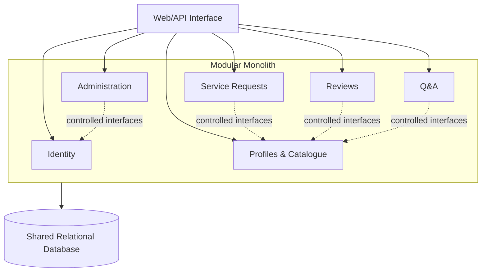

# RentYourExpert ADR Discussion Notes

## 2026-10-28 — First version

- Began Task 2 using the requirements and the saved Task 1 architecture discussion.
- Confirmed the three considered options: layered modular monolith, domain-oriented microservices, and serverless event-driven architecture.
- Used the Task 1 preferred option, the layered modular monolith, as the proposed decision.
- Created the first draft of `RentYourExpert_ADR.md` with context, alternatives, decision reasons, advantages, disadvantages, consequences, and review triggers.
- Marked the ADR as a draft rather than final so it can be reviewed and revised.
- No review changes have been requested or applied yet.

## 2026-10-28 — Length and repetition review

- The user found the first draft too long and asked for simple shortening suggestions without changing the ADR yet.
- The context summary and its following list repeat several features; they could be merged into one shorter paragraph or a smaller list of architectural drivers.
- The detailed decision paragraph repeats ideas later covered under reasons and consequences, especially one deployment, module interfaces, relational transactions, and possible future extraction.
- Reasons 3 and 4 overlap: both say that distributed architecture and its operational cost are not currently justified. They could be combined.
- Reasons 1, 2, and 5 are repeated in the advantages section as consistency, simple communication, and later extraction. Advantages could be reduced to only the strongest points or folded into the reasons.
- The positive consequences largely restate the advantages. This subsection could be removed, while the consequences section keeps only concrete obligations and trade-offs created by the decision.
- Some disadvantages reappear under negative consequences: whole-application deployment/scaling and the risk of database or module coupling. State each drawback once and keep implementation obligations separately.
- The microservices and serverless rejection paragraphs contain useful details but could each be shortened to one or two sentences focused on RentYourExpert.
- The future review triggers repeat the extraction criteria already mentioned in the decision, reason 5, and negative consequences. Keep the triggers in one place only.
- Suggested revision shape: short context, three one-sentence alternatives, decision, three concise reasons, compact advantages/disadvantages, and consequences containing only obligations and review triggers.
- No changes were made to `RentYourExpert_ADR.md` during this review.

## 2026-10-28 — First shortening revision

- Shortened `RentYourExpert_ADR.md` while keeping the layered modular monolith decision and its main reasoning.
- Combined the system summary and architectural-driver list into two concise paragraphs.
- Reduced each considered architecture to a brief description.
- Simplified the decision statement and reduced five overlapping reasons to three distinct reasons.
- Shortened the explanations for rejecting microservices and serverless event-driven architecture.
- Removed repeated advantage and disadvantage points.
- Removed the positive-consequences subsection because it repeated the advantages.
- Kept consequences focused on concrete implementation obligations and shorter review triggers.
- The ADR remains a draft for further review and has not been marked final.

## 2026-10-28 — Architecture comparison table

- Added a small table to `RentYourExpert_ADR.md` comparing all three considered architectures.
- Kept the comparison to five criteria: complexity, transactions, scalability, deployment, and suitability for RentYourExpert.
- Marked the layered modular monolith as the best initial fit while briefly showing the main trade-offs of the other options.
- Made no other changes to the ADR, which remains a draft.

## 2026-10-28 — Suggested logical diagram

- The user requested a very small logical diagram but asked not to change the ADR yet.
- Suggested a Mermaid flowchart showing a single modular-monolith boundary, the six main domain modules, and one shared relational database.
- Proposed diagram:

- Solid arrows represent entry through the web/API interface; dotted arrows give a few examples of controlled inter-module communication without showing every possible dependency.
- The single database connection keeps the diagram small; it indicates shared infrastructure while the ADR text remains responsible for explaining module-level data ownership.
- No changes were made to `RentYourExpert_ADR.md` during this discussion step.

## 2026-10-28 — Logical diagram added

- Added the proposed Mermaid architecture diagram to `RentYourExpert_ADR.md` under the chosen architecture's decision section.
- The diagram shows the web/API interface, six main domain modules inside one modular-monolith boundary, selected controlled module connections, and the shared relational database.
- Added a short legend explaining the solid and dotted arrows.
- Kept the diagram intentionally logical and compact; it does not include frameworks, deployment infrastructure, tables, or detailed dependencies.
- The ADR remains a draft for review.

## 2026-10-28 — Final review and acceptance

- Completed a final review of `RentYourExpert_ADR.md` for completeness, readability, repetition, and consistency with the Task 1 decision.
- Confirmed that the ADR contains all requested information: context, three considered architectures, the chosen architecture, decision reasons, advantages, disadvantages, and consequences.
- Confirmed that the compact comparison table and logical diagram add useful context without excessive detail.
- Found no important content missing and no further structural changes necessary.
- Changed the ADR status from draft to `Accepted`.
- Removed the draft-only notice because it was no longer applicable.
- The accepted architecture remains the layered modular monolith.

