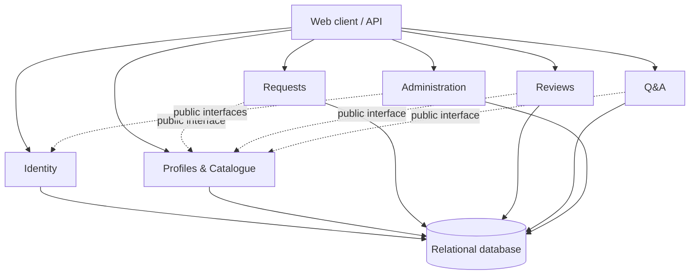

# ADR-002: Initial Architecture for RentYourExpert (Skill-Assisted Analysis)

- **Status:** Proposed
- **Date:** 2026-10-28

## Context and architectural drivers

RentYourExpert is a marketplace where customers discover workers by skill and location, inspect profiles and reviews, ask questions, and create or delete service requests. Workers maintain profiles, answer questions, and accept or reject requests. Administrators manage customers, workers, requests, reviews, and Q&A content.

The requirements explicitly call for a user-friendly interface, secure authentication and authorization, search, request management, reviews, Q&A, profiles, and administrative moderation. The resulting architectural drivers are:

- role- and ownership-based authorization for customer, worker, and administrator actions;
- consistent request state transitions and safe destructive operations;
- efficient catalogue queries by skill and location;
- aggregation of worker profile, review, and Q&A data;
- maintainable business boundaries as marketplace rules evolve; and
- sufficient isolation to prevent one module from bypassing another module's rules.

It is reasonable to infer that persisted relational data and auditability are useful, but the requirements do not specify load, availability targets, team size, budget, hosting platform, or technology stack. They also leave payment, scheduling, request lifecycle details, review eligibility, data-retention rules, notifications, and regulatory constraints unresolved. The architecture must not assume those needs.

## Considered architectures

### Option 1: Layered modular monolith

One backend deployment contains Identity, Profiles & Catalogue, Requests, Reviews, Q&A, and Administration modules. Each module owns its business rules and database tables; other modules use public application interfaces rather than internal repositories or ORM entities. A relational database supports atomic updates.

A customer request flows from the API through authorization to the Requests module. Requests obtains the worker's public identity through the Profiles interface, validates the request, and commits it in one transaction. A worker later accepts or rejects it through a guarded state transition.

**Advantages:** simple deployment and debugging, strong local transactions, low operational overhead, and easy composition of worker pages. Clear internal boundaries preserve a path to later extraction.

**Disadvantages and pain points:** the backend deploys and scales as one unit; a process failure can affect all capabilities; a shared database invites coupling unless ownership is enforced; build and release coordination can grow over time.

**Operations and fit:** start with multiple stateless application instances behind a load balancer if needed, backed by one managed relational database. This is a better fit while workflows are closely connected and one team can coordinate releases; it becomes worse if capabilities need materially different scaling, reliability, technology, or release cadence.

### Option 2: Domain-oriented microservices

Identity, Catalogue, Requests, Reviews, Q&A, and Administration become independently deployed services with owned data stores. An API gateway fronts them; synchronous APIs handle immediate validation and events propagate selected changes.

Creating a request requires the Requests service to validate identity and worker availability using service contracts or replicated reference data. The Requests service commits its own data, publishes an event, and downstream consumers update projections. Cross-service changes use eventual consistency and compensating actions rather than one database transaction.

**Advantages:** independent deployment and scaling, stronger runtime isolation, explicit ownership, and freedom to choose technology per capability.

**Disadvantages and pain points:** network failures, stale replicated data, contract versioning, event delivery, distributed tracing, more infrastructure, and harder testing. Administrative actions spanning services are especially complex.

**Operations and fit:** every service needs deployment, monitoring, security, backups, and incident handling. This becomes attractive when separate teams own stable domains or observed demand and reliability differ substantially; it is a poor initial fit without those conditions.

### Option 3: Serverless event-driven architecture

An API gateway invokes managed functions for commands and queries. Managed identity, a database, queues, and an event bus connect functions; read models support catalogue and worker-page queries.

A request-creation function authorizes and stores the request, then emits `ServiceRequestCreated`. Separate consumers notify the worker, update audit data, or refresh projections. The request write must remain authoritative; event consumers are eventually consistent and must tolerate duplicate, delayed, and out-of-order delivery.

**Advantages:** automatic scaling for bursty workloads, reduced server management, usage-based costs at low or uneven traffic, and natural support for asynchronous reactions.

**Disadvantages and pain points:** provider dependence, cold starts, fragmented local testing and tracing, execution limits, retry handling, idempotency, and more difficult multi-step consistency.

**Operations and fit:** managed infrastructure reduces server care but not observability, security, schema evolution, or failure handling. It fits asynchronous or highly variable tasks; it is worse when the main workflows need simple synchronous transactions and portable operations.

## Comparison

| Criterion | Modular monolith | Microservices | Serverless event-driven |
|---|---|---|---|
| Request consistency | Strong local transaction | Service-local; cross-service eventual | Write-local; consumers eventual |
| Operational complexity | Low to moderate | High | Moderate to high |
| Independent scaling/deployment | Limited | Strong | Strong per function |
| Failure surface | Shared process | Network and partial failures | Retries and event-delivery failures |
| Initial fit to known needs | **High** | Low | Moderate for supporting tasks only |

## Decision

Adopt a **layered modular monolith** for the initial RentYourExpert backend, with a relational database and explicit domain boundaries.

Each module owns its tables and exposes narrow interfaces. Cross-module database access is prohibited. Request lifecycle rules live in Requests; review ownership and eligibility live in Reviews; question/answer ownership lives in Q&A; Identity provides authentication and roles; Administration orchestrates authorized actions through module interfaces rather than bypassing rules.

Internal events may be added for non-critical reactions such as notifications, audit feeds, analytics, or search indexing. They are not the source of truth for transactional request state.

## Reasons and rejected alternatives

The chosen design is the simplest option that meets the stated workflows. Closely related profile, request, review, Q&A, and moderation operations benefit from in-process calls and atomic database transactions. It also avoids distributed-system overhead when there is no stated need for independent teams, deployments, or scaling.

Microservices are not selected now because their independent deployment and scaling benefits do not offset distributed consistency, network, observability, and operational costs under the known requirements. Serverless event-driven architecture is not selected for the transactional core because retries and eventual consistency make request and moderation workflows harder to reason about; its event model remains useful for optional asynchronous work.

## Consequences

### Benefits

- Straightforward transactions, development, testing, deployment, and monitoring.
- Central enforcement of authentication while retaining module-owned authorization rules.
- Efficient relational queries and composed worker views.
- A low-cost path to validate unresolved product rules before distributing the system.

### Costs and risks

- All modules share a release and much of the runtime failure domain.
- Scaling one hot capability may require scaling the whole application.
- Poor discipline could turn the database and internal code into a tightly coupled monolith.
- Extraction later requires stable module interfaces and explicit data ownership from the start.

### Obligations

- Document module-owned tables and prohibit direct access by other modules.
- Test role/ownership authorization, allowed request transitions, review changes, and cascading moderation behavior.
- Define unresolved lifecycle rules before implementation, especially review eligibility and deletion/retention semantics.
- Add database indexes for observed catalogue queries; do not introduce a separate search engine without evidence.
- Record security-sensitive administrative actions in an audit trail.

### Measurable review triggers

Revisit this decision when evidence shows one or more of the following:

- a capability repeatedly consumes more than 70% of backend resources and cannot be isolated within the deployment;
- independent teams are blocked by the shared release process in at least three releases per quarter;
- the release pipeline or regression suite exceeds an agreed delivery target for three consecutive releases;
- availability or maintenance requirements for one capability materially exceed those of the rest of the system;
- database contention or query latency breaches the agreed service objective despite indexing and query optimization; or
- a module requires a different technology or security boundary that cannot be safely hosted in the shared process.

If a trigger is met, extract only the affected module or introduce a dedicated read/search component; do not replace the whole architecture by default.
